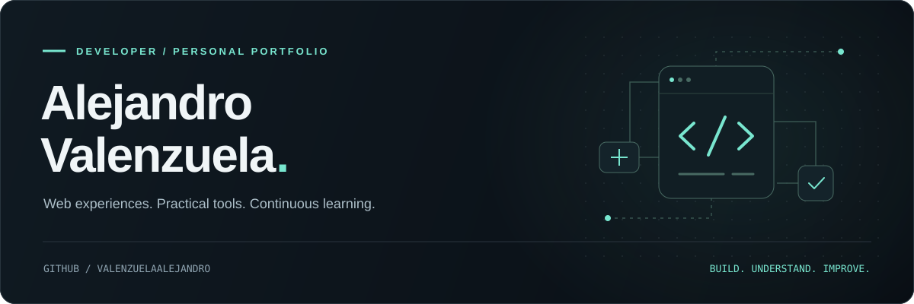

 
 

<a href="#about">About</a> &nbsp; / &nbsp;
<a href="#selected-work">Selected work</a> &nbsp; / &nbsp;
<a href="#toolkit">Toolkit</a> &nbsp; / &nbsp;
<a href="https://github.com/ValenzuelaAlejandro?tab=repositories">All repositories ↗</a>

 
 

**Building useful software. Learning through every iteration.**

I enjoy turning ideas into working tools, exploring how software works, 
and making each version a little better than the last.

 

## About

I'm **Alejandro Valenzuela**, a developer interested in web development and scripting. This profile brings together the projects I build and the things I learn along the way.

My approach is straightforward: understand the problem, build something useful, and keep refining it. I'm especially interested in the connection between a clear interface and the code behind it.

 

## Selected work

<table>
<tr>
<td>

### [Aedos ↗](https://github.com/ValenzuelaAlejandro/Aedos)

**Presentation Generator PDF**

A JavaScript project focused on generating PDF presentations.

The repository includes baseline and incremental quality checks, with ESLint and TypeScript checks that compare against existing baselines to prevent new issues.

**[Explore the repository →](https://github.com/ValenzuelaAlejandro/Aedos)** &nbsp; · &nbsp; [Read the documentation](https://github.com/ValenzuelaAlejandro/Aedos#readme)

</td>
</tr>
</table>

 

## Toolkit

The languages and tools I work with across web development and scripting.

| Area | Technologies |
| :--- | :--- |
| **Web development** |    |
| **Scripting** |   |

 

## Explore & connect

Browse my repositories to see what I'm building. For project questions, suggestions, or bug reports, open an issue in the relevant repository so the conversation stays close to the code.

&nbsp;

&nbsp;

 
 

---

Alejandro Valenzuela &nbsp; / &nbsp; Build. Understand. Improve.

